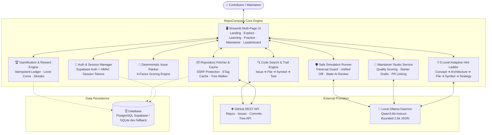

# 🧭 RepoCompass

<div align="center">

```
  ____                      ____                                        
 |  _ \ ___ _ __   ___     / ___|___  _ __ ___  _ __   __ _ ___ ___     
 | |_) / _ \ '_ \ / _ \   | |   / _ \| '_ ` _ \| '_ \ / _` / __/ __|    
 |  _ <  __/ |_) | (_) |  | |__| (_) | | | | | | |_) | (_| \__ \__ \    
 |_| \_\___| .__/ \___/    \____\___/|_| |_| |_| .__/ \__,_|___/___/    
           |_|                                 |_|                      
```

### *From your first issue to your first contribution, one issue at a time.*

An intelligent, gamified open-source onboarding platform that turns unfamiliar repositories into structured, rewarding developer journeys.

[](https://www.python.org/)
[](https://streamlit.io/)
[](https://ollama.com/)
[](https://supabase.com/)
[](app/tests/)
[](#-security--zero-trust-posture)
[](LICENSE)
[](CONTRIBUTING.md)

[Quick Start](#-quick-start) • [Architecture](#-system-architecture) • [Features](#-key-features) • [Security](#-security--zero-trust-posture) • [Demo Runbook](PRESENTATION_AND_RUNBOOK.md) • [Contributing](#-contributing)

---

</div>

## 📖 Table of Contents

- [🎯 The Problem \& Solution](#-the-problem--solution)
- [🔄 The Pedagogical Mastery Loop](#-the-pedagogical-mastery-loop)
- [⭐ Key Features](#-key-features)
  - [1. Dual-Engine Onboarding Intelligence](#1-dual-engine-onboarding-intelligence)
  - [2. Dynamic 2D Visual Workflow Infographic](#2-dynamic-2d-visual-workflow-infographic)
  - [3. Deterministic 6-Factor Issue Ranking](#3-deterministic-6-factor-issue-ranking)
  - [4. Issue-to-Code Trail (Issue → File → Symbol → Test)](#4-issue-to-code-trail-issue--file--symbol--test)
  - [5. Pedagogical 5-Level Adaptive Hint Ladder](#5-pedagogical-5-level-adaptive-hint-ladder)
  - [6. Monaco IDE Practice Lab \& Unified Diffs](#6-monaco-ide-practice-lab--unified-diffs)
  - [7. Maintainer Studio \& Health Auditor](#7-maintainer-studio--health-auditor)
  - [8. Gamification \& Tamper-Proof Reward Engine](#8-gamification--tamper-proof-reward-engine)
- [🏗️ System Architecture](#️-system-architecture)
- [🛡️ Security \& Zero-Trust Posture](#️-security--zero-trust-posture)
- [🚀 Quick Start](#-quick-start)
  - [Prerequisites](#prerequisites)
  - [Installation (Windows / macOS / Linux)](#installation-windows--macos--linux)
  - [Starting the Application](#starting-the-application)
  - [Running the Test Suite](#running-the-test-suite)
- [⚙️ Environment Configuration](#️-environment-configuration)
- [📂 Project Structure](#-project-structure)
- [📊 PRD Traceability \& Verification Matrix](#-prd-traceability--verification-matrix)
- [🎤 Presentation \& Hackathon Runbook](#-presentation--hackathon-runbook)
- [🤝 Contributing](#-contributing)
- [📜 License](#-license)

---

## 🎯 The Problem & Solution

Over **80% of aspiring open-source developers abandon their first contribution attempt**. Landing on a multi-thousand-line codebase with an outdated 20-page README creates overwhelming cognitive friction. Meanwhile, maintainers are burned out triaging incomplete bug reports.

```
                  THE OPEN SOURCE ONBOARDING CHASM
┌──────────────────────────────────────────────┬──────────────────────────────────────────────┐
│        ASPIRING CONTRIBUTORS FACE            │            MAINTAINERS FACE                  │
├──────────────────────────────────────────────┼──────────────────────────────────────────────┤
│ ❌ "README Overload": walls of unstructured text│ ❌ Repetitive, incomplete bug reports        │
│ ❌ Confusing local environment setup         │ ❌ Issues missing repro steps, OS, and logs  │
│ ❌ Mystery codebases: which files do I touch?│ ❌ Broken PRs that fail unit tests           │
│ ❌ "Good First Issues" are already claimed   │ ❌ Burnout from manual triage fatigue        │
│ ❌ Generic AI chatbots spoil code solutions  │ ❌ Abandoned PRs left in code review purgatory│
└──────────────────────────────────────────────┴──────────────────────────────────────────────┘
                                       │
                                       ▼
┌─────────────────────────────────────────────────────────────────────────────────────────────┐
│                             🧭 THE REPOCOMPASS SOLUTION                                      │
├─────────────────────────────────────────────────────────────────────────────────────────────┤
│  ✔ Grounded dual-engine toolchain detection (Poetry, npm, Cargo, pip, Go)                   │
│  ✔ Bespoke dynamic 2D visual timeline replacing raw README dumps                            │
│  ✔ Explainable 6-factor issue ranking with availability checks                               │
│  ✔ 4-stage Issue-to-Code Trail: Issue ➔ Candidate File ➔ Function/Class ➔ Matching Test     │
│  ✔ 5-level adaptive hint ladder that teaches critical thinking rather than spoiling answers │
│  ✔ Monaco IDE Practice Lab with unified diffs, static AI review, and PR assistant          │
│  ✔ Maintainer Studio for issue quality scoring, starter task generation, and PR linking     │
│  ✔ Server-side idempotent XP ledger, non-linear leveling, streaks, and opt-in leaderboards  │
└─────────────────────────────────────────────────────────────────────────────────────────────┘
```

---

## 🔄 The Pedagogical Mastery Loop

RepoCompass rejects the idea of "AI that writes code for you." Instead, it enforces a structured pedagogical progression:

$$\mathbf{Discover} \longrightarrow \mathbf{Learn} \longrightarrow \mathbf{Practice} \longrightarrow \mathbf{Contribute} \longrightarrow \mathbf{Demonstrate}$$

1. **Discover**: Ingest any public GitHub repository $\rightarrow$ instant toolchain extraction, verified setup commands, and 6-factor issue ranking.
2. **Learn**: Pick an issue $\rightarrow$ trace the `Issue → File → Symbol → Test` trail with a 5-level adaptive hint ladder.
3. **Practice**: Open the in-browser Monaco IDE sandbox $\rightarrow$ inspect code, draft a patch, review unified diffs, and receive instant static AI feedback.
4. **Contribute**: Generate an automated pull request checklist, pre-filled PR title/body, and issue-closing syntax (`Fixes #...`).
5. **Demonstrate**: Earn verified, idempotent XP, level up, unlock achievement badges, and climb opt-in community leaderboards.

---

## ⭐ Key Features

### 1. Dual-Engine Onboarding Intelligence
- **Deterministic Heuristic Engine**: Scans real repository manifests (`pyproject.toml`, `package.json`, `Cargo.toml`, `go.mod`, GitHub Actions `.github/workflows/`) to extract exact build tools, test runners, and package managers. **Zero hallucinations.**
- **Bounded Local LLM Engine**: Integrates with local **Ollama** running `qwen3:4b` using compact, schema-validated JSON prompts (<2,500 chars).
- **Graceful Offline Fallback**: If the local model is offline, the deterministic engine automatically takes over. **The user never gets an empty state or crash.**

### 2. Dynamic 2D Visual Workflow Infographic
- Replaces raw Markdown with an interactive vertical 2D timeline infographic.
- Features an amber spine with pulsing nodes and alternating glassmorphism cards (`#10B981` Emerald, `#F59E0B` Amber, `#2563EB` Royal Blue).
- Maps out repository-tailored commands for **Fork & Clone**, **Setup Environment**, **Run Tests** (`pytest`, `npm test`, `cargo test`), **Linting**, and **PR Submission**.
- Includes a one-click toggle to switch between the 2D SVG infographic and accessible Mermaid diagrams.

### 3. Deterministic 6-Factor Issue Ranking
Issues are ranked with transparent, explainable scores ($0$ to $100$) based on:
1. **Beginner Label Bonus**: Boosts `good first issue`, `beginner-friendly`, `help wanted`.
2. **Assignee Status Check**: Penalizes already-claimed issues; flags "No assignee listed" instead of assuming unclaimed.
3. **Recency & Freshness**: Prioritizes recently active issues while penalizing stale tickets (>180 days).
4. **Description Quality**: Evaluates presence of reproduction steps, code blocks, and clear acceptance criteria.
5. **Skill Match**: Matches user profile languages and frameworks to the issue scope.
6. **Blocked/WIP Penalties**: Demotes blocked or work-in-progress issues.

### 4. Issue-to-Code Trail (`Issue → File → Symbol → Test`)
- **Direct Code Search**: Tokenizes issue titles and bodies, searching the repository tree for matching source files.
- **Symbol Extraction**: Extracts candidate classes and functions using AST-inspired heuristic regexes.
- **Automated Test Pairing**: Pairs target source files (`app/services/auth.py`) with their corresponding test suites (`tests/test_auth.py`, `*.spec.ts`, `*_test.go`).
- Eliminates the frustration of searching through dozens of folders to discover where unit tests belong.

### 5. Pedagogical 5-Level Adaptive Hint Ladder
Hints adapt based on the user's declared experience level (Beginner vs. Intermediate vs. Advanced):
- **Level 1 — Concept**: High-level explanation of the problem domain.
- **Level 2 — Architecture**: Relevant subsystems, architectural layers, and modules.
- **Level 3 — Target Files**: Specific file paths requiring modification.
- **Level 4 — Symbols & Tests**: Specific classes, functions, and unit tests to run.
- **Level 5 — Implementation Strategy**: Concrete implementation logic, edge cases, and verification steps.

> [!NOTE]
> Requesting hints never awards XP and never shames the contributor. It encourages genuine learning over passive answers.

### 6. Monaco IDE Practice Lab & Unified Diffs
- **Embedded Editor**: Full-featured Monaco Editor (`vs-dark` theme) with multi-language syntax highlighting.
- **Live Unified Diff**: Generates side-by-side and unified git diffs comparing original and modified code.
- **Static AI Review**: Instant localized code review evaluating logic correctness, test coverage, and edge cases.
- **PR Assistant**: Auto-generates GitHub PR title, Markdown summary, and issue closure syntax (`Fixes #<id>`).
- **Path Traversal Guard**: Zero-trust validator (`validate_patch_security`) blocks directory traversal (`../`), system roots, and secret files (`.env`, `.git/`).

### 7. Maintainer Studio & Health Auditor
- **Issue Quality Auditor**: Evaluates issues for step-by-step reproduction steps, error logs, and expected vs. actual outcomes. Flags incomplete issues with `needs-more-information`.
- **Starter Issue Draft Generator**: Converts vague tickets or complex features into structured, beginner-friendly starter tasks.
- **Post-Merge Related Issue Intelligence**: Analyzes modified files from merged PRs and recommends open issues touching the same code paths.

### 8. Gamification & Tamper-Proof Reward Engine
- **Idempotent XP Ledger**: Transactions are keyed by `(user_id, event_type, repository_id, issue_id)`. Zero duplicate XP from page reloads or repeated button clicks.
- **Non-Linear Leveling Curve**: Derives level thresholds dynamically ($\text{Level } N = \lfloor \sqrt{XP / 100} \rfloor + 1$).
- **Streaks & Badges**: Tracks daily active streaks and awards milestones (*First Repo Analyzed*, *Practice Pioneer*, *Trail Explorer*, *Maintainer Ally*).
- **Opt-in Leaderboard**: Privacy-first personal, team, and university leaderboards without exposing emails or private data.

---

## 🏗️ System Architecture



---

## 🛡️ Security & Zero-Trust Posture

RepoCompass enforces strict defensive engineering practices:

| Security Vector | Implementation Detail | Guarantee |
|---|---|---|
| **Untrusted Code Execution** | Repository code is **never** executed directly on the host server. | Prevents arbitrary remote code execution (RCE). |
| **Path Traversal Protection** | `validate_patch_security` inspects all patch target paths using strict regex and normalization. | Rejects `../`, `/etc/`, `C:\Windows`, `.git/`, and `.env`. |
| **Server-Side Request Forgery (SSRF)** | `validate_github_url` rejects local IP addresses (`127.0.0.1`, `169.254.169.254`), non-HTTPS schemes, and non-github.com hosts. | Prevents internal network reconnaissance. |
| **Truthful Execution States** | When isolated runners are disabled (`RUNNER_ENABLED=false`), test runs display `⏸ Not run (Static review mode)`. | Zero fabricated test passes or deceptive green badges. |
| **Tamper-Proof Progression** | All XP events are computed server-side via unique constraints. | Client cannot inject or spoof XP, levels, or coins. |
| **Secret Isolation** | GitHub tokens and database keys remain strictly server-side in `.env`. | Zero credential leakage to client logs or frontend state. |

---

## 🚀 Quick Start

### 30-Second Fast Start

```powershell
# Terminal 1: Start the Local AI Engine
ollama serve

# Terminal 2: Run the Web App
.venv\Scripts\activate
streamlit run streamlit_app.py
```

Open **`http://localhost:8501`** in your browser.

---

### Prerequisites

1. **Python 3.10+** (Tested on Python 3.12)
2. **Git**
3. **[Ollama](https://ollama.com/)** with Qwen3 pulled:
   ```bash
   ollama pull qwen3:4b
   ```

### Installation (Windows / macOS / Linux)

```bash
# 1. Clone the repository
git clone https://github.com/<your-username>/repo_compass.git
cd repo_compass

# 2. Create and activate a virtual environment
# Windows (PowerShell):
python -m venv .venv
.venv\Scripts\activate

# macOS / Linux (bash/zsh):
python3 -m venv .venv
source .venv/bin/activate

# 3. Install dependencies
pip install -r requirements.txt

# 4. Set up environment variables
# Windows:
copy .env.example .env
# macOS / Linux:
cp .env.example .env
```

### Starting the Application

```bash
streamlit run streamlit_app.py
```

> [!TIP]
> **Zero-Config SQLite Mode**: If you don't have Supabase configured yet, leave `SUPABASE_URL` and `DATABASE_URL` blank in `.env`. The app will automatically initialize and use a local SQLite database (`repo_compass_dev.db`)!

### Running the Test Suite

Run all 41 test assertions across the entire system:

```bash
pytest app/tests/ -v
```

Expected output:
```text
============================= 41 passed in 4.12s =============================
```

---

## ⚙️ Environment Configuration

Copy `.env.example` to `.env` and configure as needed:

| Variable | Type | Default | Description |
|---|---|---|---|
| `APP_ENV` | String | `development` | Environment mode (`development` or `production`) |
| `DATABASE_URL` | String | *Empty (SQLite)* | Direct PostgreSQL connection string (Supabase pooler) |
| `SUPABASE_URL` | String | *Empty* | Supabase project URL for managed PostgreSQL |
| `SUPABASE_ANON_KEY` | String | *Empty* | Supabase public anonymous API key |
| `GITHUB_TOKEN` | String | *Empty* | GitHub Personal Access Token (PAT) for 5,000 req/hr rate limit |
| `OLLAMA_BASE_URL` | String | `http://localhost:11434` | Ollama server API endpoint |
| `OLLAMA_MODEL` | String | `qwen3:4b` | Model name for local inference (`qwen3:4b` or `qwen3:4b-instruct`) |
| `RUNNER_ENABLED` | Boolean | `false` | Enable/disable isolated test runner (Static review by default) |
| `MAX_REPOSITORY_FILES` | Integer | `500` | Maximum file count ingested per repository |
| `MAX_SOURCE_FILE_BYTES` | Integer | `250000` | Maximum file size for context ingestion (250 KB) |
| `MODEL_TIMEOUT_SECONDS` | Integer | `120` | Ollama request timeout threshold |

---

## 📂 Project Structure

```text
repo_compass/
├── streamlit_app.py                # Root landing page, 3D arcade gate, session router
├── pages/                          # Streamlit Multi-Page Architecture
│   ├── 01_auth.py                  # 4-step contributor onboarding & authentication
│   ├── 02_dashboard.py             # Contributor dashboard, XP progress, active issues
│   ├── 03_explore.py               # Ingestion, 2D visual workflow chart, 6-factor issue ranking
│   ├── 04_learning.py              # Issue-to-code trail (File/Symbol/Test) + 5-level hint ladder
│   ├── 05_practice.py              # Monaco IDE practice lab, diffs, static AI review, PR assistant
│   ├── 06_leaderboard.py           # Opt-in community leaderboard with podium cards
│   ├── 07_maintainer.py            # Maintainer Studio (Issue health auditor, starter drafts)
│   ├── 08_settings.py              # Profile settings, model status health check, privacy
│   └── 09_sakura_trail.py          # 3D WebGL arcade mode
├── app/
│   ├── core/
│   │   ├── config.py               # Pydantic settings & environment validation
│   │   └── security.py             # Password hashing, HMAC session tokens, SSRF protection
│   ├── db/
│   │   ├── session.py              # SQLAlchemy engine (Supabase PostgreSQL / SQLite fallback)
│   │   └── models.py               # ORM models (Users, Repos, Issues, XP, Achievements, Drafts)
│   ├── services/
│   │   ├── auth_service.py         # Registration, credentials, 4-step profile saving
│   │   ├── github_client.py        # SSRF-guarded GitHub REST API client
│   │   ├── repository_fetcher.py   # Tree fetching, ETag cache, toolchain file detector
│   │   ├── issue_ranker.py         # 6-factor deterministic scoring engine
│   │   ├── llm_service.py          # Ollama Qwen3 adapter, bounded JSON prompts, fallback
│   │   └── reward_service.py       # Idempotent XP transactions, non-linear levels, streaks
│   ├── tests/
│   │   ├── test_core.py            # Unit tests for scoring, auth, levels, code search
│   │   ├── test_fixes.py           # Database connectivity, timezone, and stale checks
│   │   ├── test_guide_and_workflow.py # Toolchain detection and 2D workflow generation
│   │   ├── test_learning_loop.py   # Symbol extraction, test pairing, adaptive hints
│   │   ├── test_maintainer_studio.py # Issue quality scoring, draft generator, PR linking
│   │   └── test_safe_simulation.py # Path traversal security guard, static review
│   └── ui/
│       └── shared.py               # Design tokens, CSS theme, navigation helpers, components
├── PRD.md                          # Full Product Requirements Document (Source of Truth)
├── PRESENTATION_AND_RUNBOOK.md     # 5-minute demo script, 10-slide deck, and judges' Q&A
├── requirements.txt                # Production dependencies
└── pytest.ini                      # Pytest configuration
```

---

## 📊 PRD Traceability & Verification Matrix

All six delivery phases specified in [PRD.md](PRD.md) have been implemented and validated against automated tests:

| Phase | PRD Module | Status | Tested Capabilities |
|---|---|:---:|---|
| **Phase 1** | **Foundation & Ingestion** | ✅ Verified | Supabase Auth + SQLite auto-fallback, SSRF-safe GitHub client, snapshot caching. |
| **Phase 2** | **Onboarding Intelligence** | ✅ Verified | Dual-engine toolchain detection, dynamic 2D visual workflow chart, 6-factor issue ranking. |
| **Phase 3** | **Learning Loop** | ✅ Verified | `Issue → File → Symbol → Test` trail linking, 5-level adaptive hint ladder. |
| **Phase 4** | **Gamification Engine** | ✅ Verified | Idempotent XP ledger, non-linear level curves, daily streak tracking, achievement badges. |
| **Phase 5** | **Maintainer Studio** | ✅ Verified | Issue health auditing (repro steps, logs, expected behavior), AI starter issue generator. |
| **Phase 6** | **Safe Simulation & Practice**| ✅ Verified | Monaco IDE (`vs-dark`), unified diffs, static AI code review, path traversal blocker. |

---

## 🎤 Presentation & Hackathon Runbook

Preparing to showcase RepoCompass? Consult our companion document:

👉 **[Master Runbook & Hackathon Presentation Guide](PRESENTATION_AND_RUNBOOK.md)**

Inside you will find:
- ⚡ **Cold-Start Runbook**: 30-second revival commands after a laptop reboot.
- ⏱️ **5-Minute Live Demo Script**: Minute-by-minute talking points for a live presentation.
- 📊 **10-Slide Blueprint**: Content and visuals for pitch decks.
- 🛡️ **Judges' Q&A Defense**: Answers to hard questions on AI hallucinations, zero-trust security, and XP idempotency.

---

## 🤝 Contributing

We welcome contributions! To get started:

1. **Fork** this repository.
2. Create a descriptive feature branch:
   ```bash
   git checkout -b feature/amazing-feature
   ```
3. Commit your changes with clear messages.
4. Verify that all unit tests pass:
   ```bash
   pytest app/tests/ -v
   ```
5. Open a Pull Request!

---

## 📜 License

Distributed under the **MIT License**. See `LICENSE` for details.

---

<div align="center">

**Built with ❤️ for the global open-source community.**  
*RepoCompass — From first issue to first contribution, one issue at a time.*

</div>
